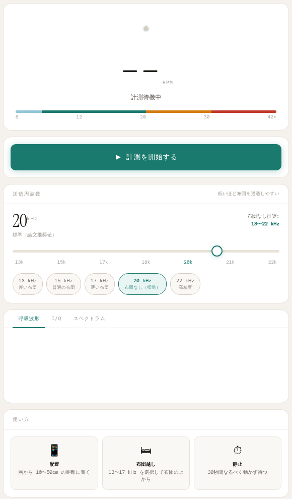

# SonarBeat

スピーカーから聞こえにくい高さの音を出し、その反射をマイクで拾って、体に触れずに呼吸数（回/分）を推定する実験的な Web アプリです。

連続波ドップラーと I/Q 復調による音響センシングの手法（コード内のコメントでは Wang et al., ACM 2021 を参照）をもとに、ブラウザだけで動くように実装しています。HTML ファイル 1 つで動作し、インストールやビルドは不要です。

**デモ:** https://mimish0778.github.io/sonar-beat/



> [!IMPORTANT]
> 実験・学習用のアプリで、安定した精度は得られていません。医療機器としての検証もしていません。健康状態の判断や、無呼吸の検知、乳幼児の見守りなどの用途には使わないでください。

## 機能

- 30 秒の計測で呼吸数（BPM）を推定し、正常範囲かどうかを色分けして表示
- 送信周波数を 13kHz〜22kHz の範囲で 0.5kHz 刻みに変更（初期値は 20kHz）
- 布団の厚さに合わせた周波数のプリセット（13、15、17、20、22kHz）
- 計測中の呼吸波形、I/Q 波形と I/Q 平面、呼吸帯域のスペクトルをリアルタイムに表示
- 開始、完了、エラーなどを時刻付きで残すログ

## 使い方

1. [デモページ](https://mimish0778.github.io/sonar-beat/) を開きます。
2. 送信周波数を選びます。布団なしなら 18〜22kHz、布団越しなら 13〜17kHz が目安です。
3. スマートフォンやパソコンを、胸から 10〜50cm の距離に置きます。布団越しに測る場合は、布団の真上 20〜35cm に固定します。
4. 「計測を開始する」を押します。初回はマイクの使用許可を求められます。
5. 30 秒間、なるべく動かずに待ちます。

計測は次の 3 つの段階で進みます。

| 段階 | 経過時間 | 内容 |
| --- | --- | --- |
| 1. 信号収集 | 0〜15 秒 | 反射音を記録する |
| 2. FFT 解析 | 15〜30 秒 | 記録しながら呼吸数を推定し、表示を更新する |
| 3. 最終結果 | 30 秒 | 計測を終え、最後の推定値を結果として残す |

計測中は、周波数のスライダーとプリセットは操作できなくなります。途中で「計測を停止する」を押すと、結果は破棄されます。

### 結果の見方

| 呼吸数 | 表示 |
| --- | --- |
| 8 未満 | 非常に遅い呼吸 |
| 8 以上 12 未満 | やや遅め |
| 12〜20 | 正常範囲 |
| 20 を超え 30 以下 | やや速め |
| 30 を超える | 非常に速い呼吸 |

### ローカルで動かす

```bash
git clone https://github.com/mimish0778/sonar-beat.git
cd sonar-beat
python3 -m http.server 8000
```

ブラウザで http://localhost:8000/ を開きます。マイクは HTTPS か `localhost` でしか使えないブラウザがあるため、`index.html` を直接開いて計測できない場合はこの方法を使ってください。

## 仕組み

1. **送信** — 指定した周波数の正弦波を `OscillatorNode` で出し続けます。
2. **受信** — `getUserMedia` で、エコーキャンセル、ノイズ抑制、自動ゲイン調整をすべてオフにしたマイク入力を取得します。音声処理のサンプルレートは 48kHz に指定しています。
3. **間引き** — 100 サンプルずつ平均して、480Hz に間引きます。
4. **I/Q 復調** — 間引いた信号に送信周波数の cos と -sin を掛け、2 次のローパスフィルタ（カットオフ 1Hz）を通して I 成分と Q 成分を得ます。
5. **位相の算出** — I 成分と Q 成分それぞれから区間ごとの中央値を差し引いてオフセットを除いたあと、`atan2(Q, I)` で位相を求め、±π の折り返しをつなげて（アンラップして）連続した波形にします。さらにメディアンフィルタで平滑化したものを呼吸波形として表示します。
6. **呼吸数の推定** — ハン窓を掛けて FFT（自前実装）を行い、0.1〜0.7Hz（6〜42 回/分）の範囲で最も強い周波数を呼吸数とします。

## 注意事項

### 精度

- 呼吸による体の動きはわずかで、体の動き、周囲の雑音、端末の位置のずれ、空調の風などによる変化と区別しにくく、誤った値が出やすくなります。
- 呼吸の有無にかかわらず、0.1〜0.7Hz の範囲で最も強い成分を結果として表示します。値が出たからといって、呼吸を正しく捉えているとは限りません。
- 観測時間が 30 秒と短いため、周波数の分解能が粗く、推定値は数回/分の単位でぶれやすくなります。
- 布団越しの計測は信号の減衰が大きく、布団なしよりも精度が下がります。
- 内蔵スピーカーとマイクの特性や配置、体格、服装によって結果が大きく変わります。

精度を上げたい場合は、複数回測って平均を取る、体の動きが少ない状態で測る、といった工夫が必要です。

### 同意とプライバシー

13kHz〜22kHz の音は気づかれにくいため、計測する相手には必ず事前に同意を得てください。同居人などを本人に知らせずに計測すると、本人が気づかないまま体の情報を取得することになります。布団越しの計測も、同意のある自分自身の体調管理などの目的にとどめてください。

### その他

- 13kHz〜22kHz の音が聞こえる人や、不快に感じる人がいます。特に若い人は高い音が聞こえやすい傾向があります。
- 端末のスピーカーやマイクによっては、高い周波数を十分に出力・録音できません。
- 計測結果は保存されません。ページを閉じるか再読み込みすると消えます。

## 技術構成

- HTML / CSS / JavaScript（ライブラリやフレームワークは不使用）
- Web Audio API（`OscillatorNode`、`ScriptProcessorNode`）、MediaDevices API
- フォント: [DM Mono](https://fonts.google.com/specimen/DM+Mono)、[Instrument Serif](https://fonts.google.com/specimen/Instrument+Serif)（Google Fonts）

## ライセンス

[MIT License](LICENSE)
